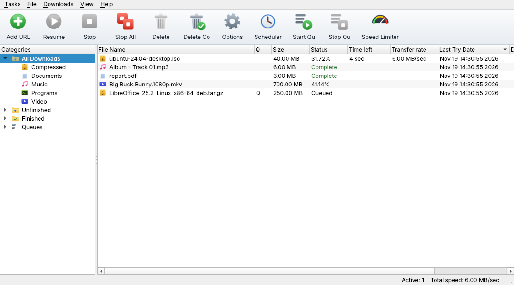
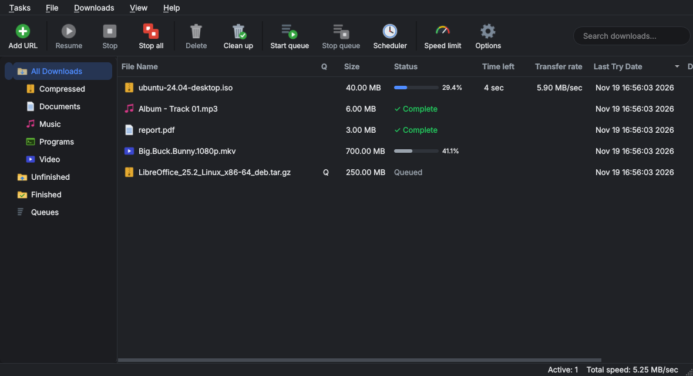
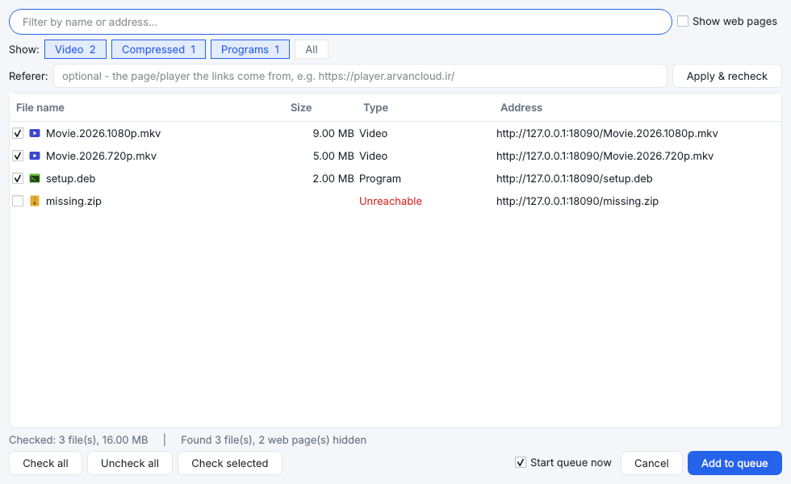
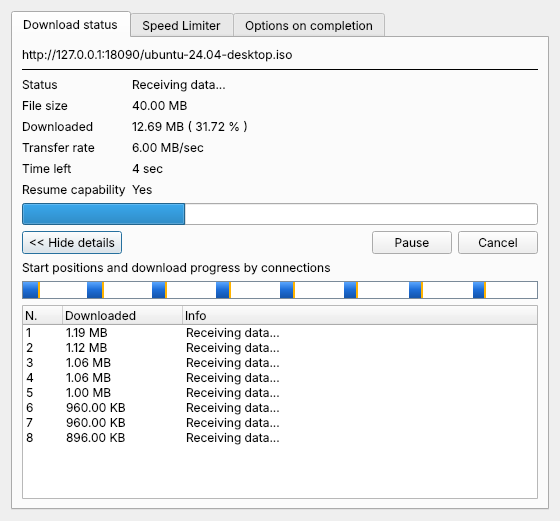
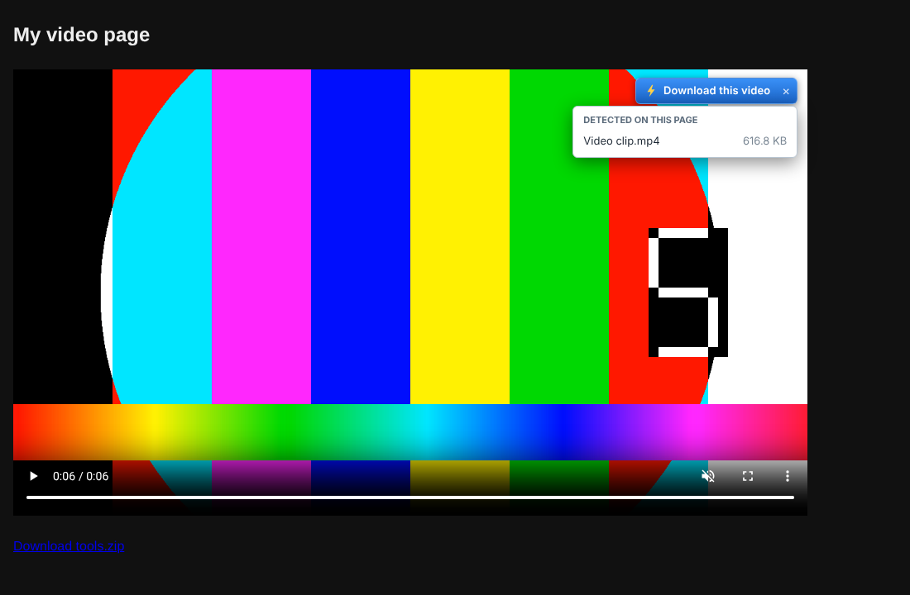

<p align="center">
  <a href="README.md">English</a> | <b>فارسی</b>
</p>

<div dir="rtl">

# تندر — Tondar Download Manager

دانلود منیجر سریع و چندتکه‌ای برای **Ubuntu 22.04 تا 26.04، ویندوز ۱۰ و ۱۱، و macOS 12 به بعد**، با افزونه‌ی مرورگر و دکمه‌ی **«Download this video»** برای یوتیوب و سایت‌های دیگر. چیدمان و روال کارش برای هر کسی که با دانلود منیجرهای کلاسیک ویندوز کار کرده آشناست.

</div>



<div dir="rtl">

## قابلیت‌ها

- **دانلود چندتکه‌ای:** تا ۳۲ کانکشن برای هر فایل، با **تقسیم پویا**. وقتی یک کانکشن تمام می‌شود، بزرگ‌ترین تکه‌ی باقی‌مانده را نصف می‌کند تا همه‌ی کانکشن‌ها تا آخر کار کنند.
- **توقف و ادامه:** دانلودها از همان جایی که قطع شده‌اند ادامه پیدا می‌کنند، حتی بعد از بستن برنامه یا قطع برق.
- **صف و زمان‌بندی:** تعیین ساعت شروع و پایان، روزهای هفته، و خاموش کردن یا Suspend سیستم بعد از تمام شدن صف.
- **محدودکننده‌ی سرعت** برای همه‌ی دانلودها.
- **دسته‌بندی خودکار:** Compressed، Documents، Music، Programs و Video، هر کدام در پوشه‌ی جدا.
- **پنجره‌های آشنا:** Download File Info، پنجره‌ی پیشرفت با نقشه‌ی تکه‌ها و لیست کانکشن‌ها، و Download complete.
- **افزونه‌ی مرورگر** برای Chrome، Chromium، Brave، Edge، Vivaldi و Firefox:
  - گرفتن خودکار دانلودهای مرورگر
  - دکمه‌ی **Download this video** روی پلیرها، با منوی کیفیت (1080p، 720p، …، M4A، MP3)
  - تشخیص فایل‌های ویدیو و صوت و استریم‌های HLS (`.m3u8`) در هر صفحه
  - منوی راست‌کلیک: «Download with Tondar» و «Download all links»
- **سایت‌های ویدیو** (یوتیوب و حدود ۱۸۰۰ سایت دیگر) از طریق [yt-dlp](https://github.com/yt-dlp/yt-dlp). آخرین نسخه‌ی yt-dlp و Deno دفعه‌ی اول خودکار دانلود و هر هفته به‌روز می‌شوند.
- **اتصال:** HTTP، HTTPS و FTP؛ پروکسی HTTP و SOCKS5؛ کوکی و Referer از مرورگر؛ Basic Auth.
- **ورود و خروج لیست دانلود:** فایل متنی، فایل خروجی IDM (`.ef2`، برای جابه‌جایی لیست بین IDM ویندوز و تندر) و لیست `.json` تندر با نام فایل‌ها و پوشه‌ها.
- **دانلود همه‌ی لینک‌ها:** همه‌ی لینک‌های صفحه در پس‌زمینه بررسی می‌شوند تا نام واقعی، حجم و نوع فایل نمایش داده شود. صفحه‌های وب مخفی می‌شوند و حجم کل فایل‌های انتخاب‌شده نشان داده می‌شود.
- **ظاهر مدرن** با تم روشن و تیره که از تنظیمات سیستم پیروی می‌کند، و ظاهر کلاسیک (Options ← General ← Appearance).
- **هماهنگی با دسکتاپ:** نظارت روی کلیپ‌بورد، آیکن در System Tray، اجرای خودکار هنگام ورود به سیستم، و اعلان‌های دسکتاپ (همه، فقط خطاها، یا هیچ).

</div>

| تم تیره | دانلود همه‌ی لینک‌ها |
|---|---|
|  |  |
| **پنجره‌ی پیشرفت** | **دکمه‌ی دانلود ویدیو در مرورگر** |
|  |  |

<div dir="rtl">

## نصب

### ویندوز ۱۰ و ۱۱

فایل **`Tondar-Setup-<version>.exe`** را از صفحه‌ی [Releases](../../releases/latest) دانلود و اجرا کنید. دسترسی ادمین لازم نیست. نسخه‌ی پرتابل (`.zip`) هم موجود است.

چون فایل نصب امضای دیجیتال ندارد، ممکن است پیغام آبی *Windows protected your PC* نمایش داده شود. روی **More info** و بعد **Run anyway** بزنید.

### macOS 12 (Monterey) به بعد

فایل `.dmg` مناسب مک خود را از [Releases](../../releases/latest) دانلود کنید: **`…-macOS-apple-silicon.dmg`** برای مک‌های M1 تا M4، و **`…-macOS-intel.dmg`** برای مک‌های اینتل. فایل را باز کنید و **Tondar** را داخل **Applications** بکشید.

چون برنامه توسط Apple تأیید (notarize) نشده، بار اول اجرا نمی‌شود:
- macOS 12 تا 14: در Applications روی Tondar راست‌کلیک کنید، **Open** را بزنید و دوباره **Open** را تأیید کنید.
- macOS 15 به بعد: یک بار برنامه را باز کنید، بعد به **System Settings ← Privacy & Security** بروید و **Open Anyway** را بزنید.
- یا در Terminal: `xattr -dr com.apple.quarantine /Applications/Tondar.app`

در ویندوز و مک، افزونه‌ی فایرفاکس از مسیر **Options ← General ← Install in Firefox** نصب می‌شود.

### اوبونتو

**نصب با یک دستور** (آخرین نسخه را دانلود و با apt نصب می‌کند):

</div>

```bash
curl -fsSL https://raw.githubusercontent.com/Afsharidevops/tondar-download-manager/main/install.sh | sh
```

<div dir="rtl">

**یا به‌صورت دستی:**

</div>

```bash
wget https://github.com/Afsharidevops/tondar-download-manager/releases/latest/download/tondar_all.deb
sudo apt install ./tondar_all.deb
```

<div dir="rtl">

همه‌ی نسخه‌ها در صفحه‌ی [Releases](../../releases) هستند. برای به‌روزرسانی، همان دستور را دوباره اجرا کنید.

</div>

<div dir="rtl">

بعد **Tondar Download Manager** را از منوی برنامه‌ها باز کنید.

### افزونه‌ی مرورگر

**Firefox:** افزونه‌ی امضاشده توسط Mozilla از طریق `/etc/firefox/policies/policies.json` خودکار نصب می‌شود. برای تکمیل:

1. Firefox را یک بار ببندید و دوباره باز کنید.
2. روی آیکن Tondar در نوار ابزار بزنید.
3. گزینه‌ی **Allow access to all websites** را بزنید.

**Chrome / Chromium / Brave / Edge / Vivaldi:**

1. به `chrome://extensions` بروید.
2. **Developer mode** را روشن کنید.
3. روی **Load unpacked** بزنید و پوشه‌ی `/usr/share/tondar/extension/chrome` را انتخاب کنید.

### نکته‌های یوتیوب

- اگر GitHub روی شبکه‌ی شما باز نمی‌شود، اول در **Options ← Proxy / Socks** پروکسی را تنظیم کنید، بعد از منوی **Downloads ← Update video engine** موتور ویدیو را به‌روز کنید.
- برای ویدیوهای محدود به سن یا خصوصی، از **Options ← Video ← Use cookies from browser** استفاده کنید.

## اجرا از روی سورس

</div>

```bash
sudo apt install python3-pyqt6 ffmpeg      # یا python3-pyqt5
python3 extension/build.py
python3 -m tondar
```

<div dir="rtl">

ساختن بسته‌ی `.deb`:

</div>

```bash
python3 packaging/build_deb.py              # -> dist/tondar_<version>_all.deb
```

<div dir="rtl">

## پیش‌نیازها

- Ubuntu 22.04 یا جدیدتر (Python 3.10 یا بالاتر)، ویندوز ۱۰ (نسخه‌ی 1809) یا جدیدتر (۶۴ بیتی)، macOS 12 یا جدیدتر
- `python3-pyqt6` یا `python3-pyqt5`
- پیشنهادی: `ffmpeg` (برای ترکیب صدا و تصویر و ساختن MP3) و `python3-socks` (برای پروکسی SOCKS)

</div>
