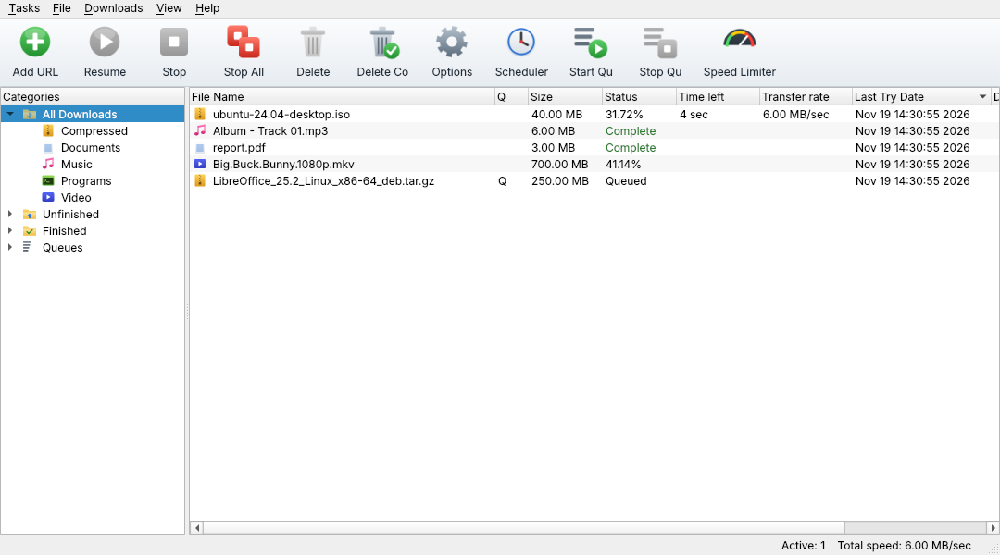
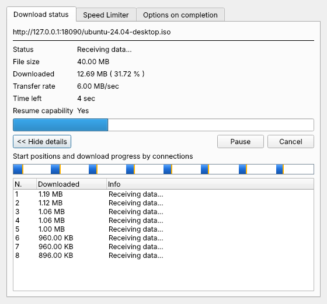
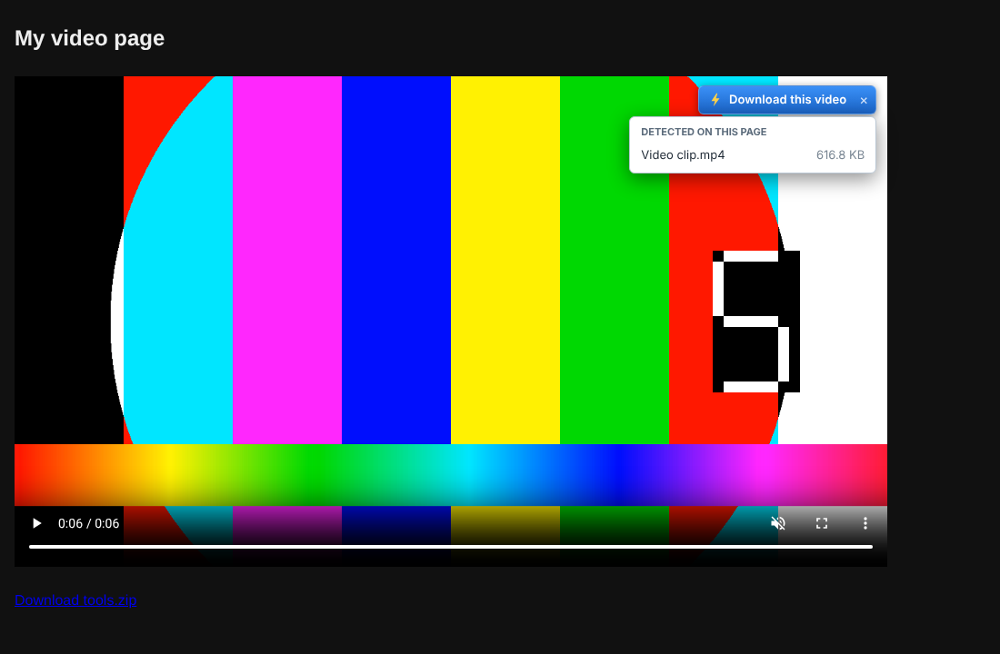

<p align="center">
  <b>English</b> | <a href="README.fa.md">فارسی</a>
</p>

# Tondar Download Manager

A fast, segmented download manager for **Ubuntu 22.04 – 26.04** with browser integration and a **"Download this video"** button for YouTube and other sites. The layout and workflow are familiar to anyone who has used a classic Windows download accelerator.



## Features

- **Segmented downloading:** up to 32 connections per file with *dynamic segmentation*. When a connection finishes, it splits the largest remaining part so every connection stays busy until the end.
- **Pause and resume:** downloads continue where they stopped, even after closing the app or a power cut.
- **Queue and scheduler:** start and stop times, days of the week, and an option to suspend or power off when the queue is done.
- **Global speed limiter.**
- **Automatic categories:** Compressed, Documents, Music, Programs and Video, each saved in its own folder.
- **Familiar dialogs:** *Download File Info*, a progress window with a segment map and connection list, and *Download complete*.
- **Browser extension** for Chrome, Chromium, Brave, Edge, Vivaldi and Firefox:
  - captures browser downloads automatically;
  - adds a **Download this video** panel on web players, with a quality menu (1080p, 720p, … M4A, MP3);
  - detects video, audio and HLS (`.m3u8`) streams on any page;
  - right-click menu: *Download with Tondar*, *Download all links*.
- **Video sites** (YouTube and about 1,800 others) through [yt-dlp](https://github.com/yt-dlp/yt-dlp). The latest yt-dlp and Deno are downloaded on first use and updated weekly.
- **Connections:** HTTP, HTTPS and FTP; HTTP and SOCKS5 proxies; browser cookies and referer; Basic Auth.
- **Desktop integration:** clipboard monitor, system tray icon, start at login, and desktop notifications (all, errors only, or none).

| Progress window | Video panel in the browser |
|---|---|
|  |  |

## Installation

**One-line install** (downloads the latest release and installs it with apt):

```bash
curl -fsSL https://raw.githubusercontent.com/Afsharidevops/tondar-download-manager/main/install.sh | sh
```

**Or manually:**

```bash
wget https://github.com/Afsharidevops/tondar-download-manager/releases/latest/download/tondar_all.deb
sudo apt install ./tondar_all.deb
```

All versions are on the [Releases](../../releases) page. To update later, run the same command again.

Open **Tondar Download Manager** from the applications menu.

### Browser extension

**Firefox** installs the Mozilla-signed add-on automatically through `/etc/firefox/policies/policies.json`. To finish:

1. Restart Firefox once.
2. Click the Tondar toolbar icon.
3. Choose **Allow access to all websites**.

**Chrome / Chromium / Brave / Edge / Vivaldi:**

1. Open `chrome://extensions`.
2. Turn on **Developer mode**.
3. Click **Load unpacked** and choose `/usr/share/tondar/extension/chrome`.

### YouTube notes

- If GitHub is blocked on your network, set a proxy in **Options → Proxy / Socks**, then use **Downloads → Update video engine**.
- For age-restricted or private videos, use **Options → Video → Use cookies from browser**.

## Running from source

```bash
sudo apt install python3-pyqt6 ffmpeg      # or python3-pyqt5
python3 extension/build.py                  # builds extension/build/{chrome,firefox}
python3 -m tondar
```

To build the `.deb` package:

```bash
python3 packaging/build_deb.py              # -> dist/tondar_<version>_all.deb
```

## Project layout

```
tondar/            application (PyQt6 / PyQt5)
  engine.py        segmented HTTP/FTP downloader
  media.py         yt-dlp integration
  manager.py       list, queue, scheduler, persistence
  server.py        local API for the browser extension (127.0.0.1:9614)
  ui/              main window, dialogs, icons
extension/src/     browser extension (MV3, Chrome + Firefox)
packaging/         .deb builder, Firefox policy installer, signed .xpi
tests/             engine, UI and end-to-end browser tests
```

## Requirements

- Ubuntu 22.04 or newer (Python 3.10 or newer)
- `python3-pyqt6` or `python3-pyqt5`
- Recommended: `ffmpeg` (merging video and audio, MP3), `python3-socks` (SOCKS proxy)
